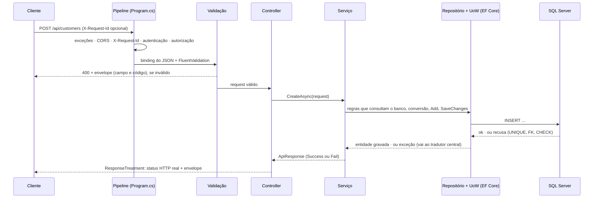

# FlixLocadora

API de **locadora de filmes** em **.NET 10**: catálogo com estoque de cópias, clientes e **locações** (alugar, prorrogar,
devolver, cancelar). Autenticação ASP.NET Core Identity + JWT, envelope único de resposta e banco **database-first
regenerável** a partir da connection string. É um dos três modelos de API para estudos de caso de entrevista — os outros
são o [TransFornecedores](https://github.com/vohdril/TransFornecedores) e o [PagWeb](https://github.com/vohdril/PagWeb) —, e
nasceu do template `interview-api` a partir do MyFlix, um catálogo pessoal de filmes em .NET 8.

> **.NET 10 · C# 14 · SQL Server (LocalDB) · 90 testes · dados 100% fictícios.** O diário de construção e as decisões
> tomadas no caminho estão em [`docs/PROGRESS.md`](docs/PROGRESS.md).

## Sumário

1. [Rodar em 3 comandos](#1-rodar-em-3-comandos)
2. [O mapa do projeto](#2-o-mapa-do-projeto)
3. [Como a API funciona — a jornada de uma requisição](#3-como-a-api-funciona--a-jornada-de-uma-requisição)
4. [O domínio: filmes, clientes e locações](#4-o-domínio-filmes-clientes-e-locações)
5. [Manutenção do banco de dados](#5-manutenção-do-banco-de-dados)
6. [CrudGen — fatias CRUD a partir do banco](#6-crudgen--fatias-crud-a-partir-do-banco)
7. [Testes](#7-testes)
8. [Autenticação — ligada por etapas](#8-autenticação--ligada-por-etapas)
9. [Para onde ir daqui](#9-para-onde-ir-daqui)

---

## 1. Rodar em 3 comandos

Pré-requisitos: **.NET SDK 10** e **SQL Server LocalDB** (vem com o Visual Studio; ou instale o SQL Server Express) — ou um
SQL Server em Docker ([`infra/docker-compose.yml`](infra/docker-compose.yml)). Comandos para o **PowerShell**, na raiz do
repositório.

```powershell
./scripts/db-up.ps1 -Seed
./scripts/dev-secrets.ps1
dotnet run --project src/FlixLocadora.Api --launch-profile http
```

**O que acontece em cada um:**

1. **`db-up.ps1 -Seed`** — cria o banco `FlixLocadora` no LocalDB (se não existir) e aplica, em ordem, os scripts de
   [`database/schema`](database/schema); com `-Seed`, também os de [`database/seed`](database/seed): 12 filmes, 6 clientes e
   5 locações **inventados** (uma atrasada, de propósito). Cada script aplicado fica registrado em `deploy.SchemaVersions` e
   nunca roda duas vezes.
2. **`dev-secrets.ps1`** (opcional) — gera uma chave JWT aleatória e pede a senha do usuário admin (digitação oculta);
   grava os dois em **user-secrets**, fora do repositório, sem imprimir nada. Sem ele, a API sobe mesmo assim em
   Development, com uma chave JWT efêmera (os tokens morrem ao reiniciar) e sem admin — e avisa no log.
3. **`dotnet run`** — sobe a API em `http://localhost:5406`. Em Development, a partida aplica as migrations do Identity
   (schema `auth`) e cria as roles `Admin` e `Operator` (e o admin, se o passo 2 rodou). Abra
   **`http://localhost:5406/scalar`** para ver e chamar todos os endpoints.

O arquivo [`src/FlixLocadora.Api/FlixLocadora.Api.http`](src/FlixLocadora.Api/FlixLocadora.Api.http) tem as chamadas prontas
(Visual Studio, VS Code com a extensão REST Client, Rider), inclusive os casos de erro do seed.

---

## 2. O mapa do projeto

Uma solução, um projeto de API, e as camadas do padrão Decco como **pastas** — cada uma com um papel e uma regra de
dependência que os testes de arquitetura vigiam:

```
src/FlixLocadora.Api
  Program.cs, Infra/, Controllers/     SolutionLayer — o "fio": pipeline HTTP, composição, autenticação, OpenAPI, erros
  Business/<Feature>/                  BusinessLayer — contratos, validadores, conversores, serviços (o que a API FAZ)
  Business/Common/                     o envelope, os códigos de erro, a base de CRUD, CPF/CNPJ
  Data/Generated/                      DataLayer gerado pelo scaffold (entidades, configurações) — nunca edite
  Data/Partials/, Data/Repositories/   DataLayer seu: unidade de trabalho, convenções, repositórios específicos
  CodeTemplates/EFCore/*.t4            os templates que dizem COMO o scaffold escreve o Data/Generated
tools/FlixLocadora.Database           DbUp: aplica database/schema e database/seed
tools/CrudGen                         gera as fatias CRUD a partir do banco
tests/FlixLocadora.Tests              unidade · integração · arquitetura · modelo × banco
database/ · scripts/ · infra/ · crudgen.json · docs/
```

| Pasta | Gerada ou sua? | Quem escreve |
|---|---|---|
| `Data/Generated/` | gerada — reescrita a cada `scaffold.ps1` | os templates T4 |
| `Business/<Feature>/Generated/*.g.cs` | gerada — reescrita a cada `crudgen.ps1` | o CrudGen |
| `Business/<Feature>/*.cs`, `Controllers/<Feature>Controller.cs` | **sua** — criada uma vez pelo CrudGen, depois nunca mais tocada | você |
| `Business/Rentals/`, `Data/Partials/`, `Data/Repositories/`, `Infra/` | **sua** — escrita à mão | você |

> **No nosso caso:** `Movies` e `Customers` são fatias do CrudGen com regras suas nos arquivos fora de `Generated/`;
> `Rentals` é escrita à mão — é onde mora a regra de negócio da locadora.

---

## 3. Como a API funciona — a jornada de uma requisição

### 3.1 O caminho, de ponta a ponta

Uma requisição atravessa as camadas sempre na mesma ordem. Vale ter este desenho na cabeça antes de abrir qualquer arquivo:



E a resposta tem **sempre** o mesmo formato, de sucesso ou de erro — o **envelope**:

```json
{ "status": "Fail", "errors": [ { "code": "CUSTOMER_CPF_INVALID", "message": "The CPF is not valid (11 digits with valid check digits).", "field": "cpf" } ], "requestId": "exercicio-1" }
```

### 3.2 Problemas que essa arquitetura resolve (antes de qualquer arquivo)

**O problema.** Os projetos-base destes modelos mostravam os defeitos clássicos de uma API que cresce sem um "fio" comum: o
MyFlix carregava a tabela inteira de filmes para **filtrar em memória**; o Fornecedores ([vohdril/Playmove](https://github.com/vohdril/Playmove))
respondia **HTTP 200 com o erro dentro do corpo** — o cliente precisava ler o JSON para saber se deu certo —, o repositório
**engolia exceções** (`catch → return false`, e o erro real nunca chegava a um log), o `PUT` montava uma entidade nova e
**sobrescrevia a data de cadastro**, o conversor **perdia campos em silêncio**, e a gestão de roles estava **aberta a qualquer
um**. Cada controller decidia sozinho o que responder; cada erro tinha um formato.

**A alternativa rejeitada.**

| Alternativa | Por que não resolve |
|---|---|
| cada controller monta a própria resposta | o formato diverge; o status HTTP vira opinião de quem escreveu |
| HTTP 200 sempre, com `success: false` no corpo | proxies, logs, retentativas e monitoramento leem o **status**, não o corpo — para eles, tudo deu certo |
| validação automática do FluentValidation (`FluentValidation.AspNetCore`) | o próprio projeto a descontinuou; validar é melhor explícito, num filtro que você lê |
| deixar a exceção do banco virar 500 | uma corrida de dois cadastros com o mesmo CPF vira "erro interno" em vez de 409 |

**A visão de mercado.** O padrão IETF para erros de API HTTP é o *Problem Details*
([RFC 9457](https://www.rfc-editor.org/rfc/rfc9457)), adotado nativamente pelo ASP.NET Core. Muitas APIs corporativas
preferem um **envelope único** para sucesso e erro — é o caso das APIs do ecossistema que serviu de referência (o padrão
Foundation.API do sandbox Decco), e este projeto o segue. O ponto inegociável nos dois mundos é o mesmo: **o status HTTP diz
a verdade** e o corpo detalha. Custo da escolha: um cliente genérico de Problem Details não entende o envelope sem
adaptação.

> **No nosso caso:** o envelope está em [`Business/Common/ApiResponse.cs`](src/FlixLocadora.Api/Business/Common/ApiResponse.cs);
> a tradução para o status HTTP, num lugar só, em [`Infra/Http/ResponseTreatment.cs`](src/FlixLocadora.Api/Infra/Http/ResponseTreatment.cs).

### 3.3 As peças, uma a uma

**O pipeline** ([`Program.cs`](src/FlixLocadora.Api/Program.cs)). É a esteira por onde toda requisição passa, na ordem em que
os `app.Use…` aparecem: tratador de exceções → redirecionamento HTTPS → CORS → `X-Request-Id` → autenticação → autorização →
endpoints. A ordem importa: o tratador de exceções vem primeiro para envolver tudo; a autenticação vem antes da autorização
porque a segunda precisa saber **quem** é o usuário. Em Development, o pipeline também publica o documento OpenAPI e o
Scalar. No fim, um `MapFallback` responde **404 no envelope** para qualquer URL desconhecida — sem ele, a política de
autorização padrão (exigir login) responderia 401 até para uma rota que não existe.

**O `X-Request-Id`** ([`Infra/Http/HttpRequestContext.cs`](src/FlixLocadora.Api/Infra/Http/HttpRequestContext.cs)). Toda
requisição ganha um identificador de correlação: o que o cliente mandou no cabeçalho `X-Request-Id` (até 64 caracteres) ou o
`TraceIdentifier` do ASP.NET. Ele volta no cabeçalho da resposta **e** no campo `requestId` do envelope, e aparece nos logs. O
problema que resolve: quando um usuário diz "deu erro", ele cita o id e você acha a linha exata no log — sem ele, é procurar
uma agulha por horário.

**Autenticação e autorização** ([`Infra/Auth/`](src/FlixLocadora.Api/Infra/Auth)). O ASP.NET Core Identity guarda usuários,
hash de senha (nunca a senha), bloqueio após 5 tentativas erradas e roles, no schema `auth`. O login devolve um **JWT**
assinado, validado em toda requisição (emissor, audiência, assinatura e validade, com 30 s de tolerância de relógio). As
políticas: `Read` = qualquer usuário autenticado, `Write` = `Admin` ou `Operator`, `Admin` = só admin. E existe uma **política
de fallback**: endpoint **sem** atributo exige login — esquecer o `[Authorize]` deixa o endpoint fechado, não aberto. 401 e
403 também saem no envelope. (Os controllers de domínio ainda estão abertos para testes — veja a [seção 8](#8-autenticação--ligada-por-etapas).)

**Validação explícita** ([`Infra/Filters/RequestValidationFilter.cs`](src/FlixLocadora.Api/Infra/Filters/RequestValidationFilter.cs)).
Antes da action rodar, um filtro procura, para cada argumento, um `IValidator<T>` do FluentValidation e o executa. Falhou →
**400** com um erro por regra, cada um com o **código** tipado (`CUSTOMER_CPF_INVALID`) e o **campo** em formato JSON
(`items[0].quantity`) — é o que permite a uma tela pintar o campo certo de vermelho. Erros de **binding** (JSON malformado,
`?page=abc`) também saem no envelope ([`Infra/Http/Envelope.cs`](src/FlixLocadora.Api/Infra/Http/Envelope.cs)). Os
validadores são **puros**: não consultam o banco — "esse CPF já existe?" é regra do serviço, e a garantia final é a
constraint `UNIQUE`.

**Controller fino** ([`Controllers/`](src/FlixLocadora.Api/Controllers)). O controller só recebe, chama o serviço e entrega o
resultado ao `ResponseTreatment`; não decide status nem tem regra. As fatias do CrudGen herdam de
[`CrudController`](src/FlixLocadora.Api/Controllers/CrudController.cs), que já expõe listar (paginado), obter, criar
(**201**), atualizar e excluir; o controller da feature só acrescenta o que é dela (`PATCH /api/movies/{id}/copies`).

**O serviço** ([`Business/<Feature>/`](src/FlixLocadora.Api/Business)). É onde a API decide. As fatias geradas herdam de
`CrudService` ([`Business/Common/Crud.cs`](src/FlixLocadora.Api/Business/Common/Crud.cs)), que faz a parte repetitiva —
buscar, converter, salvar, responder — e abre **ganchos** para o que é do domínio: `Filter`, `Order`, `OnCreating`,
`OnUpdating`, `CheckCreateAsync`, `CheckUpdateAsync`, `CheckDeleteAsync`. Uma analogia fiel: o `CrudService` é um formulário
de cadastro com os campos padrão impressos, e os ganchos são os espaços em branco onde você escreve o que é do caso. O
`PUT` **aplica** o pedido sobre a entidade rastreada — não monta uma nova (a causa do "PUT que sobrescrevia a data de cadastro").
Features que não são cadastro (as locações) têm serviço escrito à mão, sem a base.

**Repositório e unidade de trabalho** ([`Data/Repositories/Repository.cs`](src/FlixLocadora.Api/Data/Repositories/Repository.cs),
[`Data/Partials/AppDbContext.cs`](src/FlixLocadora.Api/Data/Partials/AppDbContext.cs)). O repositório genérico consulta
(`Query()` sem rastreamento, `QueryTracked()` para alterar), filtra pela chave como **parâmetro SQL** e nunca salva sozinho.
Quem salva é a **unidade de trabalho** (`IUnitOfWork`): várias alterações de vários repositórios viram um `SaveChanges` — uma
transação. Para várias instruções que precisam cair juntas, `InTransactionAsync` abre a transação **pela execution
strategy** do EF: se uma falha transitória derrubar a conexão no meio, a unidade inteira é refeita, não só a última
instrução. Exceção nunca é engolida.

**O conversor** (`Business/<Feature>/<X>Converter.cs`). Transforma contrato ↔ entidade com o
[Mapperly](https://mapperly.riok.app/docs/intro/), que gera o código de mapeamento **em tempo de compilação**. Um campo novo
sem par vira **erro de build** (`RMG012`/`RMG020`) — é assim que um campo esquecido deixa de sumir em silêncio. Regras de
normalização moram aqui: o CPF e o telefone são gravados só com dígitos, o e-mail em minúsculas
([`CustomerConverter.cs`](src/FlixLocadora.Api/Business/Customers/CustomerConverter.cs)).

**O envelope e o `ResponseTreatment`**. Os serviços devolvem um `ApiResponse` com `Status` e uma lista de erros tipados
(`ErrorCode`: código estável, mensagem, **categoria**). O `ResponseTreatment` é o **único** lugar que traduz isso para HTTP, e
o status sai da **categoria** do erro — um código novo já nasce com o status certo, sem tabela para atualizar:

| Categoria (`ErrorKind`) | HTTP | Exemplo |
|---|---|---|
| `Validation` | 400 | `VALIDATION_FAILED`, `CUSTOMER_CPF_INVALID` |
| `Unauthorized` / `Forbidden` | 401 / 403 | `UNAUTHORIZED`, `FORBIDDEN` |
| `NotFound` | 404 | `NOT_FOUND` |
| `Conflict` | 409 | `CUSTOMER_CPF_ALREADY_EXISTS`, `MOVIE_HAS_RENTALS`, `CONCURRENCY_CONFLICT` |
| `BusinessRule` | 422 | `MOVIE_UNAVAILABLE`, `CUSTOMER_HAS_OVERDUE_RENTALS` |
| `Internal` | 500 | `INTERNAL_ERROR` (detalhes só no log) |

A regra de bolso: forma errada → 400; identidade, unicidade ou concorrência → 409; regra de negócio sobre um pedido bem
formado → 422.

**Os erros do banco** ([`Infra/Errors/DbExceptionHandler.cs`](src/FlixLocadora.Api/Infra/Errors/DbExceptionHandler.cs)). Quando
o banco recusa — `UNIQUE` (erros 2601/2627), FK ou `CHECK` (547), `rowversion` mudado (`DbUpdateConcurrencyException`) —, um
tratador central traduz a recusa num erro tipado, consultando os **catálogos de constraints** de cada feature (o gerado
`CustomerConstraints` mapeia `UQ_Customer_Cpf` para `CUSTOMER_CPF_ALREADY_EXISTS`). Por que isso importa: duas requisições
com o mesmo CPF podem passar juntas pela pré-checagem do serviço; só a constraint pega a segunda — e ela recebe o mesmo 409 que
a pré-checagem daria, não um 500. O que sobra vira **500 no envelope**, com o detalhe só no log
([`UnhandledExceptionHandler.cs`](src/FlixLocadora.Api/Infra/Errors/UnhandledExceptionHandler.cs)).

**A composição por convenção** ([`Infra/CompositionRoot.cs`](src/FlixLocadora.Api/Infra/CompositionRoot.cs)). Ninguém registra
serviço à mão: toda classe que implementa uma interface derivada de `IService` ou `IRepository` é registrada pela interface,
assim como os conversores e os validadores. Criar uma feature nova não toca nesse arquivo. Um teste de arquitetura sobe o
container e confere que **tudo** resolve — um esquecimento quebra o teste, não a produção.

**OpenAPI e Scalar**. O documento OpenAPI 3.1 é gerado pelo próprio ASP.NET Core 10, com os comentários XML do código;
transformadores acrescentam a todas as operações os erros 400/404/500 com o envelope, o esquema Bearer e os 401/403 de quem
exige login. O Scalar (`/scalar`) é a interface para ler e chamar.

### 3.4 Dois caminhos: ler no código × observar rodando

| Etapa | Ler no código | Observar rodando |
|---|---|---|
| pipeline | `Program.cs` | a ordem dos logs ao subir; `GET /health` |
| `X-Request-Id` | `Infra/Http/HttpRequestContext.cs` | mande o cabeçalho e veja-o voltar (exercício abaixo) |
| autenticação | `Infra/Auth/IdentityAuth.cs`, `AuthorizationSetup.cs` | `GET /api/auth/me` sem token → 401; com token → 200 |
| validação | `Infra/Filters/RequestValidationFilter.cs`, `Business/Customers/CustomerValidators.cs` | um `POST` com CPF inválido → 400 com `field` |
| serviço e ganchos | `Business/Movies/MovieService.cs` | breakpoint em `Filter` e um `GET /api/movies?genre=Drama` |
| erro do banco | `Infra/Errors/DbExceptionHandler.cs` | dois cadastros com o mesmo CPF → 409 |
| status HTTP | `Infra/Http/ResponseTreatment.cs` | breakpoint em `General`; os testes `ResponseTreatmentTests` |
| contrato | os `*.g.cs` e os XML docs | `/openapi/v1.json` e `/scalar` |

### 3.5 Exercício: uma requisição para cada status

Com a API rodando (seção 1) e o seed aplicado. No PowerShell, use `curl.exe` (o `curl` sozinho é um apelido do
`Invoke-WebRequest`); os corpos vão num arquivo para evitar o inferno das aspas. Saídas reais:

```powershell
'{"name":"Ana Exercicio","email":"ana.exercicio@example.com","cpf":"12345678900"}' | Set-Content -NoNewline cpf-invalido.json
curl.exe -s -i -H "Content-Type: application/json" -H "X-Request-Id: exercicio-1" --data "@cpf-invalido.json" http://localhost:5406/api/customers
```

```
HTTP/1.1 400 Bad Request
X-Request-Id: exercicio-1
{"status":"Fail","errors":[{"code":"CUSTOMER_CPF_INVALID","message":"The CPF is not valid (11 digits with valid check digits).","field":"cpf"}],"requestId":"exercicio-1"}
```

O que aconteceu: o binding leu o JSON, o `RequestValidationFilter` achou o `CreateCustomerRequestValidator`, a regra de CPF
falhou (dígito verificador) e a resposta saiu **antes** do controller — com o seu id de correlação nos dois lugares.

| Troque por… | Resposta | Quem decidiu |
|---|---|---|
| o CPF `39053344705` (é do cliente 1 do seed) | **409** `CUSTOMER_CPF_ALREADY_EXISTS` | a pré-checagem em `CustomerService.CheckCreateAsync` (e a `UNIQUE`, numa corrida) |
| `POST /api/rentals` com `{"movieId":6,"customerId":2,"days":1}` | **422** `CUSTOMER_HAS_OVERDUE_RENTALS` | `RentalService` (o cliente 2 tem uma locação atrasada no seed) |
| `GET /api/movies/999999` | **404** `NOT_FOUND` | `CrudService.GetAsync` |
| `GET /api/auth/me` sem token | **401** `UNAUTHORIZED` | o `OnChallenge` do JWT Bearer |
| `GET /api/movies?genre=Drama` | **200** | `MovieService.Filter`, traduzido para SQL |

Para seguir sozinho: mande `X-Request-Id` num erro e procure o id no log do terminal; ponha um breakpoint em
`ResponseTreatment.General` e veja o status sair da categoria; abra `/openapi/v1.json` e ache o `ApiResponse`.

---

## 4. O domínio: filmes, clientes e locações

| Recurso | Endpoints | Destaques |
|---|---|---|
| Filmes | `GET/POST /api/movies` (`?genre&available&search`), `GET/PUT/DELETE /api/movies/{id}`, `PATCH /api/movies/{id}/copies` | estoque (`TotalCopies`/`AvailableCopies`) muda **só** por instruções atômicas; filtros em SQL; filme com histórico não é excluído (409) |
| Clientes | `GET/POST /api/customers`, `GET/PUT/DELETE /api/customers/{id}`, `GET /api/customers/{id}/rentals` | CPF com dígito verificador e único (409), e-mail único gravado em minúsculas, telefone só com dígitos |
| Locações | `GET/POST /api/rentals` (`?status&customerId&movieId&search`), `GET/PUT/DELETE /api/rentals/{id}`, `POST /api/rentals/{id}/return` | status **derivado** das datas (`Active`/`Overdue`/`Returned`); diária congelada no aluguel; multa por dia iniciado |
| Contas de usuário | `POST /api/auth/register · login`, `GET /api/auth/me`, gestão de roles | Identity (hash, bloqueio, roles) + JWT |

Filmes e clientes saíram do **CrudGen** (`crudgen.json`: `AvailableCopies` fora do `POST`; o estoque fora do `PUT`, que vai
pelo `PATCH …/copies`). Locações são escritas à mão (`"Rental": { "skip": true }`).

### Regras de locação

| Regra | Onde | Código (HTTP) |
|---|---|---|
| `days` de 1 a `Rental:MaxDays` | validador | `VALIDATION_FAILED` (400) |
| filme existe, ativo e com cópia — **reserva atômica** | `MovieRepository.TryReserveCopyAsync` + `CHECK` de estoque | `RENTAL_MOVIE_NOT_FOUND` / `MOVIE_UNAVAILABLE` (422) |
| cliente existe, ativo, sem locação atrasada e abaixo de `Rental:MaxActivePerCustomer` | serviço, com a linha do cliente travada | `RENTAL_CUSTOMER_NOT_FOUND` / `CUSTOMER_INACTIVE` / `CUSTOMER_HAS_OVERDUE_RENTALS` / `CUSTOMER_RENTAL_LIMIT_REACHED` (422) |
| devolução: `total = dias previstos × diária + multa`; `multa = dias de atraso (arredondados para cima) × diária × Rental:LateFeeMultiplier`; devolução antecipada não reembolsa | `RentalPricing` (função pura) | — |
| prorrogar: só locação aberta **e no prazo**; nova data depois da atual e até `MaxDays` depois do aluguel | serviço | `RENTAL_ALREADY_RETURNED` / `RENTAL_OVERDUE` / `RENTAL_DUE_DATE_NOT_LATER` / `RENTAL_MAX_DAYS_EXCEEDED` (422) |
| cancelar (lançada por engano): só aberta e dentro de `Rental:CancelWindowMinutes` | serviço | `RENTAL_ALREADY_RETURNED` / `RENTAL_CANCEL_WINDOW_EXPIRED` (422) |
| estoque não fica abaixo das cópias alugadas | `MovieRepository.TrySetTotalCopiesAsync` | `MOVIE_COPIES_IN_USE` (422) |

`RENTAL_OVERDUE` e a janela de cancelamento fecham duas brechas da multa: sem elas, prorrogar uma locação atrasada ou
cancelá-la dias depois apagaria o que o cliente deve. A configuração (seção `Rental` do `appsettings.json`) é **validada na
subida** — um valor inválido derruba a API, não uma locação: `MaxActivePerCustomer` 3 · `MaxDays` 7 · `LateFeeMultiplier` 1,5 ·
`CancelWindowMinutes` 30.

### Concorrência — quem decide é o banco

**O problema, numa cena.** Sobra uma cópia de *O Farol de Vidro* e dois atendentes clicam em "alugar" no mesmo instante. Os
dois leem `AvailableCopies = 1`, os dois conferem que há cópia, os dois gravam: duas locações para uma cópia. "Ler, conferir,
gravar" em memória **não funciona com concorrência** — entre a leitura e a gravação, o mundo mudou.

| Corrida | Técnica | Teste (integração) |
|---|---|---|
| dez atendentes alugam a **última cópia** juntos | um `UPDATE … WHERE AvailableCopies > 0` (`ExecuteUpdate`) na mesma transação do `INSERT` da locação: o banco decide numa instrução | 1 × 201, 9 × 422 `MOVIE_UNAVAILABLE`, estoque 0 |
| seis pedidos do **mesmo cliente** chegam juntos (limite 3) | `UPDLOCK` na linha do cliente (`IRepository.FindForUpdateAsync`): as locações do mesmo cliente andam em fila; as dos outros, não | 3 × 201, 3 × 422 `CUSTOMER_RENTAL_LIMIT_REACHED` |
| **clique duplo** em "devolver" | `UPDLOCK` na linha da locação: o segundo espera e encontra a locação já devolvida | 1 × 200, 4 × 422 `RENTAL_ALREADY_RETURNED`, a cópia volta uma vez só |

📖 O `ExecuteUpdate` do EF Core manda um `UPDATE` direto ao banco, fora do `SaveChanges`
([docs](https://learn.microsoft.com/ef/core/saving/execute-insert-update-delete)); o `UPDLOCK` segura a linha até o fim da
transação ([table hints](https://learn.microsoft.com/sql/t-sql/queries/hints-transact-sql-table)). Os testes de corrida foram
conferidos por mutação: sem o `UPDLOCK`, os dois últimos falham. Compare com o
[PagWeb](https://github.com/vohdril/PagWeb), que resolve o saldo com concorrência **otimista** (`rowversion`) e retentativa.

### Datas

Toda data-hora da API é **UTC** e sai com o `Z` (`"rentedAt": "2026-10-20T15:04:05Z"`). O `datetime2` do SQL Server não guarda o
tipo: sem tratamento, o EF lê `Unspecified` e o JSON sai sem `Z` — um cliente em UTC-3 mostraria 3 horas de diferença. A
conversão está no EF ([`Data/Partials/AppDbContext.cs`](src/FlixLocadora.Api/Data/Partials/AppDbContext.cs),
`ConfigureConventions`), não num conversor JSON, que apagaria o `type: string` do contrato OpenAPI. Na entrada, data com
offset (`-03:00`) é convertida; sem offset, vale como UTC.

---

## 5. Manutenção do banco de dados

### 5.1 O mapa: três schemas, três donos

O banco `FlixLocadora` tem três schemas, e cada um muda de um jeito — misturar os jeitos é a fonte de quase todo problema:

| Schema | O que guarda | Dono | Como muda |
|---|---|---|---|
| `dbo` | o domínio: `Movie`, `Customer`, `Rental` | **você**, por scripts SQL | script novo em `database/schema/` → `db-up.ps1` → `scaffold.ps1` → `crudgen.ps1` |
| `auth` | usuários, roles, claims do Identity e o histórico `__EFMigrationsHistory` | o **Identity**, por migrations do EF | `dotnet ef migrations add` (raro; seção 5.4) |
| `deploy` | `SchemaVersions`: o journal do DbUp (que script rodou e quando) | o **DbUp** | automático — não mexa |

### 5.2 Problemas que o database-first regenerável resolve

**O problema.** Num estudo de caso, o banco costuma chegar **pronto**: tabelas com nomes e tipos que você não escolheu, às
vezes com constraints e índices que já contam regras do negócio. Escrever as entidades à mão a partir dele é demorado e
erra fácil (um `nvarchar(200)` vira `MaxLength(100)`, uma coluna anulável vira obrigatória). E quando o banco muda no meio do
caminho — uma coluna nova, uma tabela renomeada —, as entidades escritas à mão ficam para trás **em silêncio**: o erro só
aparece quando a consulta roda.

**A alternativa rejeitada.**

| Alternativa | Por que não serve aqui |
|---|---|
| *code-first* com migrations do EF para o domínio | o C# vira a fonte da verdade; com um banco entregue (e com dono), é o lado errado da seta |
| entidades escritas à mão | divergem do banco sem aviso; trabalho repetitivo |
| banco por **estado** (DACPAC/SSDT: o projeto descreve como o banco *deve ser* e uma ferramenta calcula a diferença) | poderoso, mas pesado para um caso de algumas horas; e esconde *como* cada mudança foi feita |
| scaffold "cru" (o padrão do `dotnet ef`) | gera um contexto gigante com `DbSet` e `OnConfiguring` com a connection string — e mistura o que é gerado com o que é seu |

**A visão de mercado.** Bancos versionados por **scripts em ordem** (*migration-based*) são o padrão de ferramentas como
[Flyway](https://documentation.red-gate.com/flyway) e [Liquibase](https://docs.liquibase.com/) no Java e do
[DbUp](https://dbup.readthedocs.io/) no .NET: cada mudança é um arquivo revisável num pull request, aplicado uma única vez.
A engenharia reversa do EF Core ([docs](https://learn.microsoft.com/ef/core/managing-schemas/scaffolding/)) é o caminho
oficial para bancos que existem antes do código, e os templates T4
([docs](https://learn.microsoft.com/ef/core/managing-schemas/scaffolding/templates)) deixam o código gerado com a cara do
projeto. **Custo e limite:** não há *rollback* automático — desfazer é um script novo; o scaffold não traz `CHECK`
constraints nem regras para o C# (elas ficam no banco, e o catálogo de constraints as traduz).

> **No nosso caso:** o banco é a fonte da verdade, o `Data/Generated` é reescrito a partir dele a cada scaffold, e os testes
> `ModelVsDatabase` acusam qualquer diferença entre os dois.

### 5.3 Conceitos essenciais

**Script imutável e journal.** Cada arquivo de `database/schema` é aplicado **uma vez**, em ordem de nome (`0001_…`, `0002_…`),
cada um na sua transação; o DbUp registra o **nome** em `deploy.SchemaVersions`. Consequência que pega muita gente: editar um
script já aplicado **não faz nada** (o nome já está no journal) — e, pior, o banco de um colega e o seu passam a divergir sem
aviso. Mudança é sempre um **script novo**. Use nomes que contem o que o script faz (`0002_movie_director.sql`) e únicos entre
`schema/` e `seed/` (os dois usam o mesmo journal).

**Seed.** Os scripts de `database/seed` só rodam com `-Seed` e contêm **apenas dados fictícios**. Os testes nunca usam o seed:
cada execução cria um banco vazio a partir de `database/schema` e arranja o que precisa.

**Scaffold e templates T4.** O [`scaffold.ps1`](scripts/scaffold.ps1) roda `dotnet ef dbcontext scaffold` com os templates de
[`CodeTemplates/EFCore`](src/FlixLocadora.Api/CodeTemplates/EFCore). Eles impõem quatro regras: cada entidade é uma `partial
class` com o marcador `IEntity` (o repositório genérico só aceita entidades); cada tabela tem uma configuração própria
(`IEntityTypeConfiguration<T>`) com `ToTable` **explícito**; o contexto não tem `DbSet` nem connection string (ela vem da
injeção de dependência, pelo nome `ConnectionStrings:AppDb`); e um **default constante** do banco (`DEFAULT (1)`) vira
inicializador C# — sem isso, o EF 10 mandaria `false` num `bit DEFAULT 1`.

**Gerado × parcial.** O que é gerado é reescrito; o que é seu fica em [`Data/Partials`](src/FlixLocadora.Api/Data/Partials):
a unidade de trabalho e a convenção de datas UTC estão em `Data/Partials/AppDbContext.cs`, a outra metade da `partial class`
gerada. Membro a mais numa entidade? `Data/Partials/<Entidade>.cs`. Nunca em `Data/Generated` — o próximo scaffold apagaria.

**Modelo × banco.** Os testes [`ModelVsDatabaseTests`](tests/FlixLocadora.Tests/Data/ModelVsDatabaseTests.cs) conferem que
toda entidade aponta para uma tabela que existe, toda propriedade para uma coluna que existe, e toda tabela do schema tem
entidade. No database-first, uma divergência falha em silêncio até a consulta rodar; esses testes a fazem falhar no
`dotnet test`.

**Migrations do Identity.** O schema `auth` é o único que muda por migrations do EF (`Data/Auth/Migrations`), porque é o
Identity quem define essas tabelas. Em Development, a API aplica as migrations pendentes ao subir.

### 5.4 Receitas do dia a dia

Antes de qualquer receita: **commit**. Depois de cada comando, `git status` mostra o que ele mudou.

**Criar ou atualizar o banco** — `./scripts/db-up.ps1` (com `-Seed` para os dados fictícios). Idempotente: rodar de novo só
aplica o que falta.

**Adicionar uma coluna** (receita ensaiada):

```sql
-- database/schema/0002_movie_director.sql
ALTER TABLE dbo.Movie ADD Director nvarchar(120) NULL;
```

```powershell
./scripts/db-up.ps1        # aplica o 0002
./scripts/scaffold.ps1     # Movie.cs ganha Director — e o build acusa RMG012/RMG020 no MovieConverter: ESPERADO
./scripts/crudgen.ps1      # os contratos ganham Director (último parâmetro) e a API volta a compilar
dotnet test
```

O aviso do passo 2 é o Mapperly dizendo "a entidade tem um campo que o contrato ainda não tem" — o passo 3 regenera o
contrato. Mas os contratos são **records posicionais**: o campo novo entra como **último parâmetro do construtor**, então o
código que monta o record pela posição quebra com `CS7036` (no ensaio, dois pontos dos testes:
`TestData.NewMovie` e um `ToUpdate`). Acrescente o argumento novo (`Director: null`) onde o compilador apontar. Depois,
decida: a coluna entra no `POST`/`PUT`? (se não, `excludeFromCreate`/`excludeFromUpdate` no `crudgen.json`). Precisa de
regra além do tamanho? (`MovieValidators.cs`).

**Adicionar uma tabela** — script `CREATE TABLE`, `db-up`, `scaffold` (nada quebra: ninguém cita a tabela nova), `crudgen`
(cria a fatia inteira, com rota anônima e testes de fumaça), `dotnet test`. Detalhe passo a passo no
[guia do CrudGen](docs/guia-crudgen.md#4-passo-a-passo-a--uma-base-nova).

**Renomear ou remover tabelas, mudar de schema, trocar de banco** — são refatorações com etapas manuais; o
[guia do CrudGen](docs/guia-crudgen.md) tem cada cenário ensaiado (seções 5 a 7).

**Zerar o banco de desenvolvimento:**

```powershell
sqlcmd -S "(localdb)\MSSQLLocalDB" -E -Q "ALTER DATABASE [FlixLocadora] SET SINGLE_USER WITH ROLLBACK IMMEDIATE; DROP DATABASE [FlixLocadora];"
./scripts/db-up.ps1 -Seed
```

O que acontece: o `SINGLE_USER WITH ROLLBACK IMMEDIATE` derruba as conexões abertas (a API, o SSMS) para o `DROP` poder rodar;
o `db-up` recria tudo do zero. As tabelas do Identity voltam na próxima subida da API (as migrations rodam em
Development). Pelo SSMS: botão direito no banco → *Delete* → marque *Close existing connections*.

**Apontar para outro banco ou servidor** — a connection string tem **um nome só**, `ConnectionStrings:AppDb`, lido em três
camadas (a última vence): `appsettings.Development.json` (o LocalDB) → user-secrets → variável de ambiente.

```powershell
dotnet user-secrets set ConnectionStrings:AppDb "<connection string>" --project src/FlixLocadora.Api   # só nesta máquina, fora do git
$env:ConnectionStrings__AppDb = "<connection string>"                                                  # só nesta sessão do PowerShell
```

Os scripts (`db-up`, `scaffold`, `crudgen`) e a API leem o mesmo nome. Connection string com senha nunca vai para um arquivo
versionado.

**SQL Server em Docker** — siga os comentários de [`infra/docker-compose.yml`](infra/docker-compose.yml): crie `infra/.env` com
`MSSQL_SA_PASSWORD=<senha forte>` (o arquivo é ignorado pelo git), `docker compose -f infra/docker-compose.yml up -d`, aponte o
`AppDb` para `Server=localhost,14333;…` por user-secrets e rode o `db-up`.

**Mudar algo do Identity** (um campo novo no usuário, por exemplo):

```powershell
dotnet tool restore     # uma vez por máquina: instala o dotnet-ef da versão fixada em .config/dotnet-tools.json
dotnet ef migrations add <Nome> --project src/FlixLocadora.Api --context AuthDbContext --output-dir Data/Auth/Migrations
```

Não passe `--namespace`: o snapshot iria parar numa pasta errada. A migration roda na próxima subida em Development.

**Conferir o modelo contra um banco qualquer** (por exemplo, o banco entregue de um estudo de caso):

```powershell
$env:MODEL_DB_CONNECTION = "<connection string>"; dotnet test --filter Category=ModelVsDatabase; Remove-Item Env:MODEL_DB_CONNECTION
```

**Quando o scaffold trava** com `The project does not build: fix it before scaffolding.` — o build já estava quebrado antes
de ele começar (o caso típico: um scaffold anterior apontado para o schema errado gerou um modelo vazio). Volte o modelo do
último commit e rode de novo, do jeito certo: `git restore src/FlixLocadora.Api/Data/Generated`.

### 5.5 Dois caminhos: PowerShell × ferramenta gráfica

| Ação | PowerShell / CLI | SSMS ou VS Code (extensão *SQL Server (mssql)*) |
|---|---|---|
| conectar | `sqlcmd -S "(localdb)\MSSQLLocalDB" -E -d FlixLocadora` | servidor `(localdb)\MSSQLLocalDB`, autenticação do Windows |
| ver o que o DbUp aplicou | `sqlcmd … -Q "SELECT ScriptName, Applied FROM deploy.SchemaVersions"` | expandir *Tables* → `deploy.SchemaVersions` → *Select Top 1000 Rows* |
| ver tabelas e chaves | `sqlcmd … -Q "SELECT name FROM sys.tables"` | *Object Explorer* → *Tables* → *Keys* e *Constraints* |
| criar ou atualizar | `./scripts/db-up.ps1` | — (scripts são aplicados pelo DbUp, nunca à mão) |
| gerar o DDL de um banco entregue | — | botão direito no banco → *Tasks* → *Generate Scripts…* |
| zerar | `sqlcmd … -Q "ALTER DATABASE … DROP DATABASE …"` | botão direito → *Delete* → *Close existing connections* |

O CLI serve para repetir e automatizar (é o que os scripts e a CI usam); a ferramenta gráfica, para inspecionar rápido e
entender o que existe. 📖 [SSMS](https://learn.microsoft.com/ssms/) ·
[extensão mssql do VS Code](https://learn.microsoft.com/sql/tools/visual-studio-code-extensions/mssql/mssql-extension-visual-studio-code) ·
[LocalDB](https://learn.microsoft.com/sql/database-engine/configure-windows/sql-server-express-localdb).

### 5.6 Roteiro de investigação

Rode no SSMS (ou com `sqlcmd -d FlixLocadora -Q "…"`), nesta ordem:

```sql
SELECT ScriptName, Applied FROM deploy.SchemaVersions ORDER BY Applied;            -- 1. o histórico do DbUp
SELECT s.name AS [schema], t.name AS [table] FROM sys.tables t
  JOIN sys.schemas s ON s.schema_id = t.schema_id ORDER BY 1, 2;                   -- 2. os três schemas
SELECT name, definition FROM sys.check_constraints;                                -- 3. as regras que só o banco conhece
SELECT name, OBJECT_NAME(parent_object_id) AS [table] FROM sys.foreign_keys;       -- 4. as FKs (e os nomes que os catálogos citam)
SELECT name, filter_definition FROM sys.indexes WHERE has_filter = 1;              -- 5. os índices filtrados de locações abertas
SELECT MigrationId FROM auth.__EFMigrationsHistory;                                -- 6. o que o Identity aplicou
```

Depois, compare o item 3 com `Data/Generated/Configurations/MovieConfiguration.cs`: os `CHECK` **não** estão lá — é o limite do
scaffold, e é por isso que o `DbExceptionHandler` existe.

---

## 6. CrudGen — fatias CRUD a partir do banco

O CrudGen lê o banco (o mesmo modelo que o scaffold lê) e gera, por tabela, uma **fatia**: contratos, regras que o banco
determina, erros tipados das constraints, validadores, conversor, serviço, controller e testes de fumaça — mais o diagrama
[`docs/modelo-de-dados.md`](docs/modelo-de-dados.md). Os `*.g.cs` são reescritos a cada execução; o resto é criado **uma vez** e
passa a ser seu. O [`crudgen.json`](crudgen.json) guarda o que o banco não diz (pular uma tabela, tirar uma coluna do
`POST`/`PUT`).

```powershell
./scripts/crudgen.ps1 -DryRun       # o que ele faria, sem gravar nada
./scripts/crudgen.ps1               # todas as tabelas
./scripts/crudgen.ps1 -Entity Movie # uma tabela
./scripts/crudgen.ps1 -PruneOwned   # e remove as fatias de tabelas que sumiram, com os arquivos seus
```

👉 **[Guia do CrudGen](docs/guia-crudgen.md)** — passo a passo ensaiado para usar o projeto numa **base nova**, **renomear
tabelas** (com e sem código escrito à mão), **reiniciar o mapeamento num schema novo** e **trocar de domínio** neste
repositório; o que sai com **nomes em português**; e uma tabela de onde operar em cada situação.

---

## 7. Testes

```powershell
dotnet test                                            # os 90
dotnet test --filter "FullyQualifiedName~RentalsTests" # uma classe
dotnet test --filter Category=ModelVsDatabase          # só modelo × banco
```

Cada execução cria um banco **descartável** no LocalDB a partir de `database/schema` — com o mesmo DbUp dos desenvolvedores,
então os scripts também são testados — e o apaga no fim. `TEST_DB_CONNECTION` aponta para outro servidor (um container na CI,
por exemplo).

| Tipo | O que protege | Exemplos |
|---|---|---|
| unidade | contas exatas, sem banco nem relógio | `RentalPricingTests` (multa com horários exatos), CPF/CNPJ |
| integração | cada regra da tabela da seção 4, pela API em memória | as três corridas, multa com atraso arranjado direto no banco, datas UTC nos dois sentidos, configuração inválida derrubando a subida |
| arquitetura | as fronteiras que o compilador não vê num projeto só | o DI resolve tudo, contratos não expõem entidades, controllers não usam o DataLayer, lista de anônimos, `Generated` intocado |
| modelo × banco | o database-first não diverge em silêncio | `ModelVsDatabaseTests` |

Os testes de corrida foram conferidos por **mutação**: tirar a proteção (o `UPDLOCK`) faz o teste falhar — um teste de
concorrência que passa com e sem a proteção não prova nada.

---

## 8. Autenticação — ligada por etapas

Os controllers de domínio nascem com `[Authorize(Policy = …)]` **e** `[AllowAnonymous]`: como o `[AllowAnonymous]` vence, tudo
fica aberto para os testes iniciais (o build mostra o aviso **ASP0026** como lembrete). O arquivo
[`AnonymousEndpoints.txt`](tests/FlixLocadora.Tests/Architecture/AnonymousEndpoints.txt) é o **interruptor**: um teste de
arquitetura falha se algum endpoint anônimo não estiver na lista. Para **ligar**:

1. apagar a linha `[AllowAnonymous]` de `MoviesController`, `CustomersController` e `RentalsController`;
2. tirar `api/movies`, `api/customers` e `api/rentals` da seção *testing phase* do `AnonymousEndpoints.txt`;
3. rodar `./scripts/dev-secrets.ps1` (ou definir `Jwt__SigningKey` e `Auth__AdminPassword` no ambiente).

Políticas: `Read` = autenticado · `Write` = Admin ou Operator (o `/register` dá Operator) · `Admin` = exclusão de filmes e
clientes e gestão de roles (cancelar locação é `Write`). A postura de segurança muda no **code review**, visível no diff —
nunca por uma flag de configuração.

---

## 9. Para onde ir daqui

- **Entender por dentro:** siga o exercício da [seção 3.5](#35-exercício-uma-requisição-para-cada-status) com breakpoints em
  `RequestValidationFilter`, `CustomerService.CheckCreateAsync` e `ResponseTreatment.General`.
- **Mudar o banco:** a [receita de adicionar coluna](#54-receitas-do-dia-a-dia) é o primeiro passo; o
  [guia do CrudGen](docs/guia-crudgen.md) cobre o resto.
- **Usar num caso novo:** o [passo a passo A do guia](docs/guia-crudgen.md#4-passo-a-passo-a--uma-base-nova).
- **Comparar técnicas de concorrência:** o [TransFornecedores](https://github.com/vohdril/TransFornecedores) (`UNIQUE` → 409
  numa corrida e `version` → 409) e o [PagWeb](https://github.com/vohdril/PagWeb) (otimista com retentativa e idempotência).
